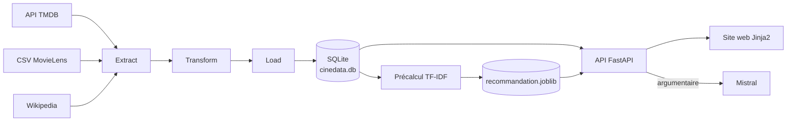
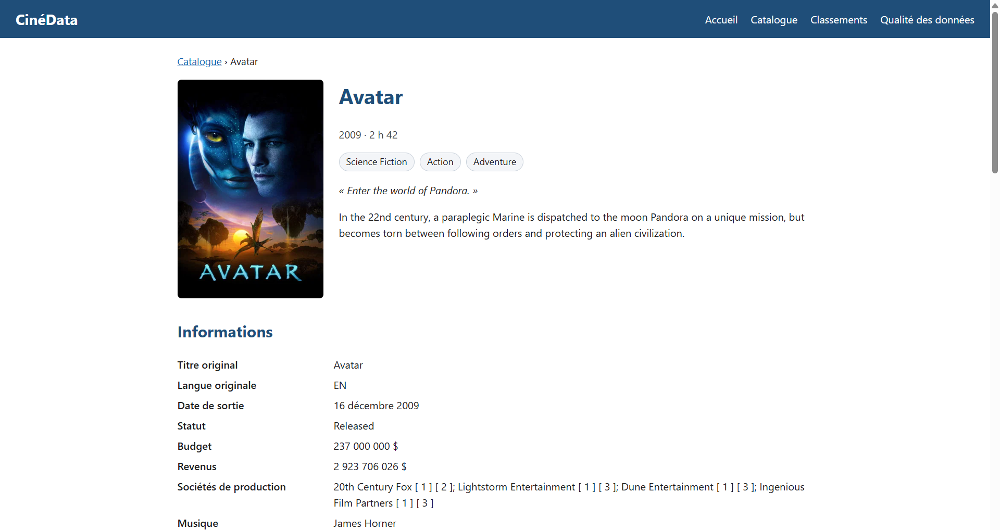

# CinéData


      

Projet 1, Phase 4 — Bloc de compétences 1 (Dev IA).
De trois sources hétérogènes à un site web : pipeline ETL, base relationnelle, API REST, recommandation de films par IA et interface web.

> **Statut : projet finalisé.** Pipeline ETL, API REST (FastAPI), recommandation par contenu, recommandation enrichie par un LLM (Mistral) et site web (Jinja2) sont fonctionnels.

---

## Objectif

Construire un jeu de données cinéma unifié à partir de trois sources différentes (API, fichier CSV, scraping web), le modéliser en base relationnelle, l'exposer via une API REST, y ajouter des services d'IA (recommandation) et le présenter dans un site web.

## Architecture



## Sources de données

| Source | Type | Contenu | Script |
|---|---|---|---|
| [API TMDB](https://developer.themoviedb.org/docs) | API REST | Films populaires (100 pages), détails, casting/réalisation, chemin de l'affiche (`poster_path`) | `extract_api_tmdb.py` |
| [MovieLens (ml-latest-small)](https://grouplens.org/datasets/movielens/) | Fichier CSV | Notes moyennes, nombre d'avis, tags — filtré sur les films déjà extraits de TMDB | `extract_csv_movielens.py` |
| Wikipedia (EN) | Scraping | Résumé, musique, sociétés de production — recherche par titre + vérification par année | `extract_web_wikipedia.py` |

L'API TMDB est la source principale : les deux autres branches enrichissent uniquement les films déjà identifiés par l'extraction TMDB.

**Mentions :**
- Ce produit utilise l'API TMDB mais n'est ni soutenu ni certifié par TMDB. Les affiches affichées sur le site sont chargées depuis les serveurs d'images de TMDB.
- Les textes issus de Wikipedia sont publiés sous licence [CC BY-SA](https://creativecommons.org/licenses/by-sa/4.0/deed.fr).

## Pipeline ETL

Voir [`docs/pipeline_etl.md`](docs/pipeline_etl.md) pour le détail complet (diagrammes Mermaid : vue d'ensemble, extraction TMDB en 3 phases, schéma de base de données).

```
extract_api_tmdb.py ─┐
extract_csv_movielens.py ├─→ data/raw/*.json   (Extract)
extract_web_wikipedia.py ─┘
                              │
                    transform.py   (Transform)
                              │
              data/processed/films_transformes.json
                              │
                       load.py   (Load)
                              │
                     data/cinedata.db
                              │
          precompute_recommandation.py   (IA)
                              │
              data/models/recommandation.joblib
```

La base SQLite comporte 6 tables : `films`, `genres`, `film_genre`, `personnes`, `film_personne`, `film_tag`.

## API REST

Application FastAPI (Pydantic pour la validation et la documentation). Les requêtes SQL sont externalisées dans `sql/`. Les listes sont paginées par 10.

| Endpoint | Description |
|---|---|
| `GET /info` | Informations sur l'API |
| `GET /health` | Vérification de l'état du service |
| `GET /movie/` | Liste paginée des films |
| `GET /movie/{id}` | Fiche détaillée d'un film (genres, équipe, tags, affiche) |
| `GET /top_actor/` | Acteurs les plus présents |
| `GET /top_director/` | Réalisateurs les plus présents |
| `GET /top_revenue/` | Films aux plus gros revenus |
| `GET /top_budget/` | Films aux plus gros budgets |
| `GET /recommendation/{film_id}` | Films similaires (TF-IDF + similarité cosinus) |
| `GET /enhanced_recommendation/{film_id}` | Films similaires + argumentaire généré par un LLM |

Documentation interactive : `http://127.0.0.1:8000/docs`.

## Site web

Pages rendues côté serveur avec Jinja2 (héritage de gabarits, macros, filtres personnalisés), qui réutilisent les fonctions de l'API. Styles dans `static/style.css`, sans dépendance externe.

| Page | URL | Contenu |
|---|---|---|
| Accueil | `/` | Chiffres clés, films à découvrir |
| Catalogue | `/catalogue` | Recherche par titre, filtre par genre, pagination |
| Fiche film | `/film/{id}` | Affiche, informations, équipe, tags, films similaires |
| Avis de l'assistant | `/film/{id}/avis` | Argumentaire généré par le LLM |
| Classements | `/classements` | Top acteurs, réalisateurs, revenus, budgets |
| Qualité des données | `/qualite-donnees` | Taux de complétude par champ |




## Services d'IA

**Recommandation par contenu.** Chaque film est représenté par un texte (genres, résumé, équipe, tags) vectorisé en TF-IDF ; les films proches sont trouvés par similarité cosinus. Le calcul est fait une fois par `precompute_recommandation.py` et sauvegardé dans `data/models/recommandation.joblib`, chargé au démarrage de l'API.

**Recommandation enrichie par un LLM.** Les films candidats sont transmis à un modèle Mistral qui rédige un argumentaire. Le modèle et ses paramètres se règlent dans la section `llm` de `config.yaml`. La clé `MISTRAL_API_KEY` se renseigne dans `.env`. En cas d'échec du service (limite de débit, indisponibilité), l'API répond `503` avec un message sans détail interne.

> Le texte généré par un LLM peut contenir des erreurs ou des informations inventées (hallucinations). Il ne se substitue pas aux données de la base.

## Structure du projet

```
cinedata/
├── .env.example            # TMDB_API_KEY, MISTRAL_API_KEY
├── .gitignore
├── README.md
├── requirements.txt
├── config.yaml             # constantes du projet (URLs, dossiers, timeouts, LLM, affiches...)
├── api/
│   ├── main.py             # application FastAPI, montage de /static
│   ├── config.py
│   ├── database.py         # accès SQLite, exécution des fichiers SQL
│   ├── schemas.py          # modèles Pydantic
│   ├── moteur_recommandation.py
│   ├── assistant_llm.py    # appel à Mistral (retry, gestion d'erreurs)
│   ├── filtres_jinja.py    # filtres de gabarits (dollars, date_fr, duree...)
│   └── routers/
│       ├── system.py
│       ├── movies.py
│       ├── rankings.py
│       ├── recommendation.py
│       └── pages.py        # pages du site
├── templates/
│   ├── base.html, accueil.html, catalogue.html, film.html,
│   │   avis.html, classements.html, qualite_donnees.html, erreur.html
│   └── composants/         # macros : affiche, carte_film, pagination, tableau_classement
├── static/
│   └── style.css
├── data/
│   ├── raw/                # sorties brutes des extractions (JSON, CSV MovieLens)
│   ├── processed/          # sortie de transform.py
│   ├── models/             # recommandation.joblib (généré)
│   └── cinedata.db         # base SQLite (générée, non versionnée)
├── sql/
│   ├── schema.sql          # schéma de la base de données (6 tables)
│   ├── movies_*.sql        # liste, comptage, détail, recherche
│   ├── top_*.sql           # classements
│   └── stats_accueil.sql, genres_liste.sql, qualite_donnees.sql, recommandation_donnees.sql
├── docs/
│   ├── pipeline_etl.md     # diagrammes du pipeline et du schéma de données
│   └── images/
│       └── cinedata_banner.svg
├── notebooks/
│   ├── extract_api_exploration.ipynb
│   ├── poo_demo_comparative.ipynb
│   ├── scraping_demo.ipynb
│   ├── modelisation_demo_v2.ipynb
│   ├── fastapi_demo.ipynb
│   ├── recommandation_demo.ipynb
│   └── enhanced_recommendation_demo.ipynb
└── src/
    ├── extract_api_tmdb.py         # Extract — API TMDB (3 phases)
    ├── extract_csv_movielens.py    # Extract — CSV MovieLens
    ├── extract_web_wikipedia.py    # Extract — scraping Wikipedia
    ├── transform.py                # Transform — fusion des 3 sources
    ├── load.py                     # Load — écriture en base
    ├── db.py                       # fonctions de création/insertion réutilisées par load.py
    └── precompute_recommandation.py  # calcul TF-IDF et sauvegarde du modèle
```

## Installation

```bash
python -m venv venv
source venv/bin/activate   # ou venv\Scripts\Activate.ps1 sous Windows
pip install -r requirements.txt
cp .env.example .env       # puis renseigner TMDB_API_KEY (et MISTRAL_API_KEY pour la recommandation enrichie)
```

Télécharger et dézipper le jeu de données [MovieLens ml-latest-small](https://files.grouplens.org/datasets/movielens/ml-latest-small.zip) dans `data/raw/ml-latest-small/`.

## Utilisation

**1. Construire les données**

```bash
python src/extract_api_tmdb.py        # -> data/raw/tmdb_movies.json
python src/extract_csv_movielens.py   # -> data/raw/movielens_avis.json
python src/extract_web_wikipedia.py   # -> data/raw/wikipedia_misc.json

python src/transform.py               # -> data/processed/films_transformes.json
python src/load.py                    # -> data/cinedata.db
python src/precompute_recommandation.py   # -> data/models/recommandation.joblib
```

**2. Lancer l'API et le site** (depuis la racine du projet)

```bash
uvicorn main:app --reload --app-dir api
```

- Site web : <http://127.0.0.1:8000/>
- Documentation de l'API : <http://127.0.0.1:8000/docs>

**Rappels**
- Relancer `precompute_recommandation.py` après chaque rechargement de la base, sinon le modèle ne correspond plus aux données.
- Si le schéma change (`sql/schema.sql`), supprimer `data/cinedata.db` avant de relancer `load.py` : les tables existantes ne sont pas recréées.

Tous les chemins, URLs, pauses entre requêtes, paramètres du LLM et constantes d'affichage des affiches sont centralisés dans `config.yaml`.

## État d'avancement

- [x] Extraction API TMDB (3 phases : films populaires, détails, casting/réalisation, affiche)
- [x] Extraction CSV MovieLens (notes agrégées, tags)
- [x] Extraction par scraping Wikipedia (recherche + vérification par année)
- [x] Transform : fusion des 3 sources, normalisation
- [x] Modélisation et chargement en base SQLite (schéma à 6 tables)
- [x] API REST (FastAPI)
- [x] Recommandation par contenu (TF-IDF + similarité cosinus)
- [x] Recommandation enrichie par un LLM (Mistral)
- [x] Site web (Jinja2)
- [ ] Note technique de fin de projet

## Limites et pistes d'amélioration

- Pas d'authentification sur l'API : choix de périmètre pour ce projet.
- Pas de tests automatisés : choix de périmètre pour ce projet, piste naturelle pour la suite (tests de l'API, intégration continue).
- Argumentaire LLM : le prompt est volontairement simple, ce qui permet d'observer des incohérences et d'étudier des améliorations (contraintes de format, vérification des faits à partir de la base).
- Quota du service Mistral dépendant du compte : prévoir un modèle disponible dans la section `llm` de `config.yaml`.

## Notes techniques

- Base de données : SQLite (fichier local, pas de serveur à configurer)
- Aucune donnée personnelle identifiante collectée
- Clés API (TMDB, Mistral) gérées via variables d'environnement (`.env`, non versionné)
- Affiches : seul le chemin relatif TMDB (`poster_path`) est stocké ; l'URL complète est construite à l'affichage à partir de `config.yaml`
- Gestion du rate limit (429) et des erreurs réseau centralisée dans chaque script d'extraction — un échec ponctuel n'interrompt jamais tout le pipeline
- `data_transformee: data/processed` — convention de nommage alignée sur les autres projets

---

*Auteur : RémiJ — Projet réalisé dans le cadre de la formation Développeur d'application IA.*