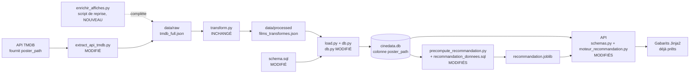

# Support Atelier — Reprendre l'ETL pour ajouter un champ (les affiches)
## Projet CinéData — Document formateur

**En lien avec :**
- `src/enrichir_affiches.py` (script de reprise, nouveau)
- `src/extract_api_tmdb.py`, `src/transform.py`, `src/load.py`, `src/db.py`, `src/precompute_recommandation.py`
- `sql/schema.sql`, `sql/recommandation_donnees.sql`, `sql/qualite_donnees.sql`
- `api/schemas.py`, `api/moteur_recommandation.py`, `api/filtres_jinja.py`, `api/routers/pages.py`
- `templates/` (macro `affiche`, déjà prête), `config.yaml` (section `tmdb`)
- Atelier précédent : `Support_Atelier_Front_Jinja2.md` (les pages affichent un visuel de remplacement en attendant cette donnée)

**Durée totale : ~1h30 à 2h**

**Objectifs pédagogiques**
- Mesurer l'impact d'un **changement de besoin** (« afficher des affiches ») sur toute la chaîne : extraction, transformation, chargement, base, précalcul, API, affichage
- Distinguer ce qui doit changer de ce qui n'a pas à changer (le Transform ici), et savoir pourquoi
- Écrire un **script de reprise** relançable pour compléter des données existantes sans refaire toute l'extraction
- Repérer les **échecs silencieux** (champ oublié dans une liste de colonnes, objet de réponse qui filtre un champ) et les vérifier étape par étape
- Rattachement REAC : **C4** (base de données : modèle physique et programmation de l'import), **C5** (exposition des données par l'API)

---

## 0. Repositionnement (à dire en ouverture)

Les pages affichent depuis hier un visuel de remplacement « Affiche non disponible ». C'est une situation très courante en projet : **un besoin nouveau arrive, et la donnée n'existe pas dans le pipeline**. Plutôt que de la bricoler à l'arrivée (dans le gabarit), on la fait remonter à la source et on la fait traverser chaque étape.

Question à poser au groupe avant de montrer quoi que ce soit : *« d'après le schéma du pipeline, quels fichiers faut-il toucher pour qu'une nouvelle information TMDB s'affiche sur le site ? »* Laisser les étudiants dresser la liste, puis comparer avec la carte ci-dessous.

---

## 1. La carte des modifications (~20 min)

| Fichier | Modification | Si on l'oublie |
|---|---|---|
| `config.yaml` (section `tmdb`) | `image_base_url`, `taille_affiche` | Rien de visible : le code utilise des valeurs par défaut. À discuter : pourquoi les mettre quand même en configuration ? |
| `extract_api_tmdb.py` | `poster_path` dans `extraire_champs_populaire()` | Les prochaines extractions n'auront pas d'affiche ; les données existantes sont couvertes par le script de reprise |
| `enrichir_affiches.py` | Nouveau : complète les films déjà extraits | — |
| `transform.py` | **Rien** | Voir ci-dessous |
| `schema.sql` | Colonne `poster_path` dans `films` | Au chargement : `table films has no column named poster_path` (le piège de la base obsolète déjà vu) |
| `db.py` (`inserer_film`) | `"poster_path"` dans la liste des colonnes | **Aucune erreur** : la colonne reste vide pour tous les films. Échec silencieux (voir section 3) |
| `recommandation_donnees.sql` + `precompute_recommandation.py` | Sélectionner et transmettre `poster_path` | Les cartes « films similaires » restent sans affiche |
| `moteur_recommandation.py` | Renvoyer `poster_path` (et gérer `NaN`) | Plantage ou champ absent selon le cas (voir section 3) |
| `schemas.py` (`FilmDetail`, `FilmRecommande`) | Champ `poster_path` | **Aucune erreur** : Pydantic filtre le champ de la réponse, l'API ne l'expose pas |
| `filtres_jinja.py`, `pages.py`, gabarits | Déjà prêts (le filtre `url_affiche` construit l'URL) ; `pages.py` affiche juste une ligne de plus dans la page de qualité | — |

### Pourquoi `transform.py` ne change pas
Le film est un dictionnaire transmis tel quel : `poster_path` traverse l'étape sans qu'on ait à la toucher. Bon exemple de **conception qui a payé** : l'étape Transform ne liste pas les champs un par un, elle ne modifie que ce qu'elle doit modifier (genres, fusions MovieLens et Wikipédia). Contre-exemple à évoquer : `db.py`, lui, liste les colonnes une à une, ce qui oblige à y revenir.

### Pourquoi stocker le chemin relatif et non l'URL complète
TMDB fournit un chemin relatif (`/abc123.jpg`). L'URL complète se construit avec une adresse de base et une taille d'image (à retrouver dans la documentation TMDB, section sur les images, ou via l'endpoint de configuration de l'API). On stocke seulement le chemin, et on construit l'URL à l'affichage avec les valeurs de `config.yaml` : si la taille change ou si l'hébergeur change, **aucune donnée n'est à retoucher**.

---

## 2. Script de reprise ou extraction complète ? (~15 min)

Trois façons d'obtenir `poster_path` pour les films déjà en base :

| Option | Avantage | Inconvénient |
|---|---|---|
| **A. Relancer toute l'extraction** | Simple en apparence | La liste « films populaires » de TMDB change chaque jour : l'ensemble des films n'est plus le même. Les données MovieLens et Wikipédia, collectées pour les films d'origine, sont désynchronisées ; il faut tout rejouer (scraping compris, plusieurs minutes) |
| **B. `UPDATE` direct en base** | Très rapide | Casse la reproductibilité : refaire le pipeline depuis zéro ne donnerait pas la même base |
| **C. Script de reprise sur le JSON brut, puis rejouer Transform et Load** | Mêmes films, pipeline reproductible, relançable | Un script de plus à maintenir |

On retient **C**. Propriétés à faire remarquer dans `enrichir_affiches.py` :
- il **réutilise** `appeler_api()` et les constantes de `extract_api_tmdb.py` (pas de code dupliqué, gestion du 429 déjà faite) ;
- il est **idempotent** : un film qui a déjà `poster_path` est ignoré ; en cas d'interruption ou d'échec sur quelques films, on relance simplement le script ;
- il fait une **copie de sécurité** (`.bak`) du fichier brut avant de le modifier ;
- `None` n'est pas une erreur : TMDB peut ne pas avoir d'affiche pour un film (la clé est alors présente avec la valeur `null`, et ne sera pas redemandée).

Durée à prévoir : un appel par film, avec la pause configurée (de l'ordre de la minute ou deux pour 200 films).

---

## 3. Démo guidée (~35 min)

### Déroulé (depuis la racine du projet, environnement activé)

1. Montrer une réponse brute de `/movie/{id}` (notebook d'exploration ou Swagger TMDB) et repérer `poster_path`.
2. Modifier `config.yaml`, `extract_api_tmdb.py`, `schema.sql`, `db.py`, `recommandation_donnees.sql`, `precompute_recommandation.py`, `moteur_recommandation.py`, `schemas.py`.
3. `python src/enrichir_affiches.py` → vérifier le fichier brut (`poster_path` présent, certains à `null`).
4. `python src/transform.py` (inchangé, simplement rejoué).
5. **Supprimer `data/cinedata.db`**, puis `python src/load.py` : le chargement n'ajoute pas de colonne à une table qui existe déjà.
6. `python src/precompute_recommandation.py` : sinon l'API sert un artefact périmé, sans erreur visible.
7. Relancer l'API, ouvrir une fiche film, puis la page « Qualité des données » (ligne « Affiche »).

### Vérifier à chaque étape (réflexe à ancrer)

| Après… | Vérification |
|---|---|
| Le script de reprise | Le message final indique le nombre de films avec affiche ; ouvrir le JSON |
| Le chargement | `SELECT COUNT(*) FROM films WHERE poster_path IS NOT NULL;` |
| Le précalcul | Appeler `/recommendation/{id}` et lire `poster_path` dans la réponse |
| L'API | `/movie/{id}` contient `poster_path` |
| Les pages | L'image s'affiche, avec le visuel de remplacement pour les films sans affiche |

### Trois pannes à provoquer volontairement

1. **Oublier `poster_path` dans la liste de `db.py`** : le chargement réussit, la base contient `NULL` partout, la page de qualité affiche 0 %. Aucune erreur nulle part. Question : *comment l'aurait-on découvert sans la page de qualité ?*
2. **Oublier le champ dans `schemas.py`** : la base est bonne, mais l'API ne renvoie pas le champ. Pydantic ne lève rien, il filtre. Message à retenir : une réponse « sans erreur » n'est pas une réponse « correcte ».
3. **Un film sans affiche dans le précalcul** : pandas transforme la valeur manquante en `NaN` (un `float`, « vrai » dans un `if`). Sans précaution, `/recommendation` plante (`Input should be a valid string`), et le filtre `url_affiche` pourrait construire une adresse invalide avec `nan`. C'est la **troisième fois** que ce piège apparaît dans le projet : on le traite avec `pd.isna()`, et le filtre n'accepte qu'une vraie chaîne non vide.

Le même traitement a été appliqué à `runtime` dans `moteur_recommandation.py` : un film dont la durée est absente aurait provoqué la même erreur. Occasion de montrer qu'un test sur un film sans affiche révèle des défauts jamais vus sur les films « complets ».

---

## 4. Pratique guidée (~30 min)

### Consigne

Chaque étudiant, sur son propre projet :

1. Ajoute `poster_path` à son extraction, son schéma, son chargement, son API et son affichage, en suivant sa propre chaîne.
2. Écrit (ou adapte) un **script de reprise** idempotent pour ses données existantes.
3. Rejoue la chaîne et complète sa liste de vérifications (tableau ci-dessus).
4. Constate le résultat dans son site : affiche réelle ou visuel de remplacement, jamais une image cassée.

### Pistes pour les plus rapides
- Ajouter un **second champ** de leur choix (par exemple l'image de fond `backdrop_path`) en refaisant le parcours sans aide, puis en comptant les fichiers touchés.
- Afficher une **miniature** dans le catalogue, avec une taille d'image plus petite définie en configuration.
- Ajouter à la page de qualité des données un contrôle de **cohérence** (par exemple : films avec affiche mais sans résumé).

### Points de vigilance formateur

- **Base obsolète** : `CREATE TABLE IF NOT EXISTS` ne modifie pas une table existante. Après changement du schéma, supprimer le fichier de base et recharger (sinon `no column named poster_path`).
- **Rechargement et doublons** : `load.py` insère les tags sans vérification de doublon ; recharger dans une base non vide les dupliquerait. Autre raison de repartir d'une base vide.
- **Artefact périmé** : le précalcul doit être relancé après chaque rechargement.
- **Conditions d'utilisation de TMDB** : les images sont servies par TMDB ; le pied de page du site rappelle la mention d'attribution demandée. Vérifier leurs conditions avant toute publication du site hors contexte pédagogique.
- **Clé API** : le script de reprise utilise la clé TMDB du fichier `.env`, comme l'extraction. Ne jamais la committer.
- **Versions locales** : si un étudiant a modifié un de ces fichiers depuis l'atelier correspondant, appliquer seulement les lignes de la carte plutôt que remplacer le fichier.
