# Guide étudiant — Recommandation enrichie par un LLM
## Ouverture IA · Projet CinéData

---

## Introduction

Votre API sait déjà recommander des films avec un moteur de similarité : rapide, gratuit, reproductible, mais il ne produit que des listes. Cet atelier ajoute un **LLM** (un modèle de langage, ici de Mistral AI) qui rédige une recommandation argumentée, sur le ton d'une critique de cinéma, à partir des films déjà choisis par votre moteur. Vous allez surtout apprendre à **appeler un service d'IA externe**, à **juger sa réponse avec un œil critique**, et à **l'intégrer proprement** dans votre API.

---

## Concepts

**Le LLM ne choisit rien : il commente.** Le moteur de similarité sélectionne les films ; le LLM reçoit cette liste dans son prompt et rédige un texte. Si le service est en panne, votre route `/recommendation/{film_id}` continue de fonctionner.

**Un LLM génère du texte plausible, pas du texte vrai.** Même avec la consigne « n'invente rien », il peut ajouter une année, attribuer un acteur au mauvais film, ou justifier un classement par des raisons qui ne sont pas celles du moteur. Votre rôle d'ingénieur est de **vérifier** ce qui sort, pas de lui faire confiance.

**Un service externe a des contraintes qu'un calcul local n'a pas :** une clé secrète, des limites de requêtes (par seconde, par minute), des pannes possibles, des réponses qui changent d'un appel à l'autre. Votre code doit les anticiper.

```mermaid
sequenceDiagram
    participant C as Client (Swagger)
    participant R as Route enhanced_recommendation
    participant M as moteur_recommandation
    participant A as assistant_llm
    participant L as Mistral (service externe)

    C->>R: GET /enhanced_recommendation/{film_id}
    R->>M: recommander(film_id)
    M-->>R: films similaires (ou None)
    alt film inconnu
        R-->>C: 404
    else film trouvé
        R->>A: generer_argumentaire(titre, films)
        A->>L: prompt + paramètres
        alt réponse correcte
            L-->>A: texte
            A-->>R: texte
            R-->>C: 200 {film_source, argumentaire, films_recommandes}
        else erreur 429 ou panne
            L-->>A: erreur
            A-->>R: ErreurLLM
            R-->>C: 503
        end
    end
```

---

## Définitions

| Terme | Signification |
|---|---|
| LLM | Modèle de langage de grande taille : il génère du texte à partir d'un texte (le prompt) |
| Prompt | Le texte envoyé au modèle : consignes + données. Sa qualité conditionne celle de la réponse |
| Message `system` / `user` | `system` fixe le rôle et le ton du modèle ; `user` porte la demande |
| Token | Unité de découpage du texte, utilisée pour mesurer la taille d'un prompt, d'une réponse, et les limites du service |
| `temperature` | Degré de variation de la réponse : basse = plus stable, haute = plus variée |
| `max_tokens` | Plafond de longueur de la réponse ; au-delà, elle est coupée net |
| `finish_reason` | Raison de l'arrêt : `stop` (fin normale) ou `length` (coupée par `max_tokens`) |
| Hallucination | Information inventée présentée comme vraie |
| Ancrage (*grounding*) | Fournir au modèle les données réelles sur lesquelles s'appuyer, plutôt que le laisser répondre de mémoire |
| Erreur 429 | « Trop de requêtes » : une limite de débit est atteinte |
| Erreur 503 | « Service indisponible » : le code que votre API renvoie quand le LLM ne répond pas |

---

## Mise en œuvre

### 1. Préparer l'accès

- Créez un compte sur la console Mistral et générez une **clé API**.
- Placez-la dans un fichier `.env` à la racine du projet : `MISTRAL_API_KEY=votre_clé`.
- **Vérifiez que `.env` est dans votre `.gitignore` avant votre premier commit.** Une clé publiée sur un dépôt distant doit être considérée comme compromise.
- Installez le SDK dans l'environnement de votre projet (`mistralai`) et ajoutez-le à votre `requirements.txt`.
- Ouvrez la page **Limites** de la console : elle indique, pour chaque modèle, les requêtes par seconde et les tokens par minute autorisés **pour votre compte**.

### 2. Valider l'appel dans un notebook

Dans `notebooks/enhanced_recommendation_demo.ipynb`, avancez dans l'ordre :
- créez le client et listez les modèles ;
- faites un premier appel minimal (sans rapport avec les films) pour valider clé, modèle et réseau ;
- lisez la réponse : texte, `finish_reason`, nombre de tokens ;
- expérimentez `temperature` et `max_tokens` sur des questions courtes.

**Point de vigilance :** un modèle peut apparaître dans la liste et renvoyer pourtant une erreur 429 dès le premier appel, si votre compte n'a aucune requête autorisée sur ce modèle. Regardez la page *Limites* et les en-têtes de la réponse avant de réessayer en boucle : si la limite est à 0, changez de modèle (dans `config.yaml`) au lieu d'attendre.

### 3. Lire la réponse d'un œil critique

Comparez la réponse du LLM au prompt qui lui a été envoyé, phrase par phrase :
- Quelles informations viennent du prompt ? Lesquelles n'y figurent pas (année, personnage, thème) ?
- Les noms d'acteurs et de films sont-ils exacts ?
- La longueur et le format demandés sont-ils respectés ?
- La réponse suit-elle la liste fournie, sans oubli ni regroupement ?

Notez vos constats : ils serviront de base aux améliorations ci-dessous.

### 4. Passer en module API

Transposez dans `api/assistant_llm.py` :
- le chargement de la clé et des paramètres (section `llm` de `config.yaml`) ;
- la construction du prompt ;
- l'appel au modèle.

Trois différences avec le notebook :
- **En cas d'erreur, levez une exception** (`ErreurLLM`) au lieu de renvoyer `None` : le code appelant ne peut pas oublier de tester.
- **Créez le client au premier appel**, pas à l'import : l'API doit démarrer même si la clé est absente.
- **Réessayez en cas de 429**, avec une attente de plus en plus longue, un nombre limité de fois. Les autres erreurs sont remontées tout de suite.

Donnez à ce module un nom clairement différent de celui du router.

### 5. Exposer la route

Ajoutez `GET /enhanced_recommendation/{film_id}` dans `routers/recommendation.py` :
- appelle `recommander()` (comme `/recommendation`), `404` si le film est inconnu ;
- appelle `generer_argumentaire()` ;
- renvoie `{film_source, argumentaire, films_recommandes}`, décrit par un modèle Pydantic ;
- traduit `ErreurLLM` en `HTTPException(503, ...)` avec un message clair, sans détail interne.

### 6. Tester

Dans Swagger : un film valide, un identifiant inconnu, puis la clé retirée du `.env` (la route enrichie répond 503, `/recommendation/{film_id}` continue de fonctionner).

### Rappel important

Le service est limité en débit : n'appelez pas la route en boucle dans une cellule ou un script, et gardez une pause d'environ une seconde entre deux appels de test.

---

## Perspectives : améliorer la qualité de la réponse

Chaque piste se teste en comparant des réponses **avant / après** sur les mêmes trois ou quatre films.

| Axe | Idée | Ce que vous apprenez |
|---|---|---|
| **Prompt** | Format de sortie imposé (un paragraphe par film, ou JSON), exemple de réponse attendue, interdiction explicite de citer un nom absent de la liste | À donner des consignes mesurables plutôt que générales |
| **Données fournies** | Ajouter synopsis, année, slogan au prompt | L'ancrage : le modèle s'appuie sur du texte réel plutôt que sur sa mémoire |
| **Paramètres** | Température plus basse, `max_tokens` cohérent avec la longueur demandée | L'effet de chaque paramètre, de façon mesurée |
| **Contrôle en aval** | Vérifier que les noms cités figurent dans les données fournies et que la longueur est respectée ; régénérer ou rejeter sinon | Ne pas faire confiance à une consigne : vérifier le résultat |
| **Choix du modèle** | Comparer un petit et un gros modèle (qualité, durée, tokens, limites) | Les bases d'un benchmark : critères, mesures, recommandation |
| **Évaluation** | Jeu de films de test + grille de relecture (exactitude, respect des consignes, utilité) | Passer de « ça me semble bien » à une évaluation reproductible |
| **Robustesse** | Cache des réponses, délai maximal, repli sans LLM (renvoyer au moins la liste) | Concevoir pour la panne |
| **Sécurité** | Se méfier du texte externe inséré dans le prompt (résumés, synopsis) : il peut contenir des instructions | L'injection de prompt |

---

## Pour poursuivre vers les assistants LLM

Ce que vous venez de construire est la première brique d'un assistant : un LLM relié à vos données. Les étapes suivantes ajoutent progressivement de l'autonomie.

- **Sortie structurée** : demander au modèle un JSON (un argumentaire par film) et le valider avec Pydantic, comme vos autres réponses d'API.
- **RAG** : au lieu de tout mettre dans le prompt, retrouver les passages utiles (résumés Wikipédia, synopsis) dans une base, puis les fournir au modèle.
- **Outils (*function calling*)** : laisser le LLM décider d'appeler vos fonctions (`recommander`, `top_actor`...) pour répondre à une question libre comme « quel est le film le plus rentable de Nolan ? ».
- **Serveur MCP** : exposer ces fonctions selon un protocole standard, utilisable par plusieurs assistants.
- **Modèles ouverts et exécution locale** : tester un modèle open source (par exemple via Hugging Face) pour comparer coût, confidentialité et qualité avec un service hébergé.
- **Suivi** : mesurer latence, coût en tokens et taux d'échec (lien avec le monitoring d'un modèle).

---

## Ressource complémentaire

**[Documentation de l'API Mistral](https://docs.mistral.ai/)** — liste des modèles, paramètres de l'appel de génération de texte, limites de débit.

**[FastAPI : gestion des erreurs](https://fastapi.tiangolo.com/tutorial/handling-errors/)** — `HTTPException` et codes de statut, pour traduire une panne de service en réponse claire.
