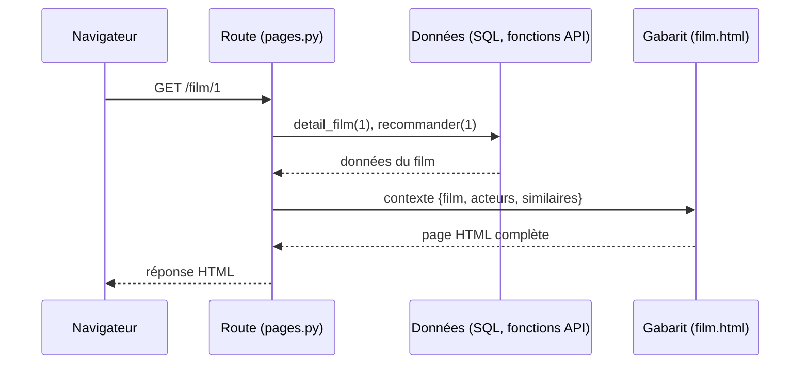
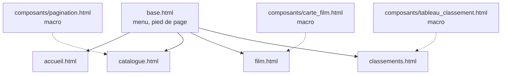

# Guide étudiant — Des pages web avec les templates Jinja2
## Ouverture vers le front · Projet CinéData

---

## Introduction

Votre API renvoie du JSON : parfait pour un programme, peu lisible pour un humain. Cet atelier ajoute un **site web** à votre projet : des pages HTML générées par votre application à partir de **gabarits Jinja2**. Vous réutilisez ce qui existe déjà (vos requêtes SQL, vos fonctions d'API) et vous découvrez comment présenter des données, y compris incomplètes, d'une façon lisible et accessible.

---

## Concepts

**Un gabarit est une page HTML avec des « trous ».** La route Python prépare un dictionnaire de données (le *contexte*), Jinja2 remplit les trous et le navigateur reçoit une page HTML complète. Le même gabarit sert pour tous les films.

**Le site et l'API partagent la même source.** Les pages appellent les mêmes fichiers `.sql` et les mêmes fonctions que votre API : une requête écrite une fois alimente les deux.

**Les données réelles sont incomplètes.** Un film peut ne pas avoir de budget, de résumé ou de note. Une page qui affiche « None » ou qui plante n'est pas acceptable : le gabarit doit prévoir l'absence.



**L'héritage évite de répéter la structure commune.** Le menu et le pied de page sont écrits une seule fois, dans `base.html` ; chaque page ne définit que son contenu.



*(trait plein : « hérite de » ; pointillé : « utilise la macro de »)*

---

## Définitions

| Terme | Signification |
|---|---|
| Gabarit (*template*) | Fichier HTML contenant des instructions Jinja2 |
| `{{ ... }}` | Affiche une valeur : `{{ film.title }}` |
| `` | Exécute une instruction : boucle, condition, héritage |
| Contexte | Dictionnaire transmis par la route au gabarit |
| Héritage | `` et `...` |
| Filtre | Transformation appliquée avec `\|` : `{{ film.budget \| dollars }}` |
| Macro | « Fonction » Jinja qui produit un bloc de HTML réutilisable |
| Fichier statique | Fichier servi tel quel (CSS, images), sans traitement par Jinja |
| Échappement | Transformation des caractères spéciaux (`<`, `>`) en texte, pour qu'un contenu externe ne soit jamais exécuté comme du code |

---

## Mise en œuvre

### 1. Préparer le projet

Installez `jinja2` dans l'environnement de votre projet et ajoutez-le à votre `requirements.txt`. Créez à la racine du projet :

```
templates/          # vos gabarits HTML
  composants/       # vos macros
static/             # votre feuille de style
api/routers/pages.py
```

Comme pour les fichiers `.sql`, calculez les chemins depuis la racine du projet, pas depuis le dossier de lancement.

### 2. Un premier gabarit

`templates/base.html` : la structure commune. Un exemple minimal :

```html
<!doctype html>
<html lang="fr">
<head>
  <meta charset="utf-8">
  <title>Accueil · CinéData</title>
  <link rel="stylesheet" href="{{ url_for('static', path='style.css') }}">
</head>
<body>
  <header>…menu…</header>
  <main></main>
  <footer>…</footer>
</body>
</html>
```

Une page fille hérite de ce squelette :

```html


  <h1>CinéData</h1>
  <p>{{ stats.nb_films }} films dans le catalogue.</p>

```

### 3. Une première route

Dans `pages.py`, une route renvoie une `TemplateResponse` :

```python
templates = Jinja2Templates(directory=str(RACINE_PROJET / "templates"))

@router.get("/")
def accueil(request: Request):
    stats = executer_fichier_sql("stats_accueil.sql")[0]
    return templates.TemplateResponse(request, "accueil.html", {"stats": stats})
```

Dans `main.py`, montez le dossier `static` (`app.mount("/static", StaticFiles(...))`) et ajoutez votre router. Déclarez-le avec `include_in_schema=False` : il renvoie du HTML, il n'a pas sa place dans Swagger.

### 4. Les pages à réaliser

| Page | Contenu | Notions |
|---|---|---|
| **Accueil** | Chiffres clés (films, personnes, genres, années), 5 plus gros revenus, champ de recherche | Variables, boucle `for … else` |
| **Catalogue** | Liste de 10 films par page, recherche par titre, filtre par genre, pagination | Formulaire GET, condition, macro |
| **Fiche film** | Toutes les informations d'un film, équipe, tags, résumé Wikipédia | Filtres, `set`, valeurs manquantes |
| **Classements** | Top acteurs, réalisateurs, revenus, budgets | Une macro pour quatre tableaux |
| **Extensions** | Films similaires, avis du critique (URL dédiée), qualité des données | Macros, gestion d'erreur, agrégation |

Pour le catalogue, écrivez **deux requêtes SQL** : une pour les résultats (avec `LIMIT` et `OFFSET`), une pour le comptage (même filtre), comme pour la pagination de l'API. Utilisez des paramètres nommés (`:q`, `:genre`) passés sous forme de dictionnaire quand une valeur sert plusieurs fois.

### 5. Gérer les valeurs manquantes

Aucune page ne doit afficher `None` ou planter à cause d'une donnée absente. Deux outils :

- Écrire vos propres **filtres** (une simple fonction Python) pour formater : montant en dollars, date en français, durée en heures et minutes.
- Utiliser le filtre `default` pour remplacer une valeur vide :

```html
{{ film.budget | dollars | default("Non renseigné", true) }}
```

Le second argument `true` est indispensable : sans lui, `default` ne remplace que les valeurs *non définies*, pas les chaînes vides ni les zéros.

### 6. Éviter la répétition

Quand un bloc de HTML apparaît plusieurs fois (une carte de film, un tableau de classement), écrivez une **macro** dans `templates/composants/` et importez-la :

```html

{{ tableau_classement(acteurs, "name", "nombre_films", "Acteur", "Films") }}
```

Quand une liste d'éléments identiques s'affiche (informations d'un film : libellé + valeur), préférez une boucle sur une liste de couples à N blocs HTML copiés-collés.

### 7. Afficher un service externe fragile

Si vous ajoutez une page qui appelle un LLM, placez-la sur **sa propre URL** (par exemple `/film/{id}/avis`) : l'appel prend plusieurs secondes et peut échouer. La fiche film reste ainsi toujours rapide. En cas d'échec, affichez un message clair dans la page (avec un lien pour réessayer) au lieu d'une réponse JSON.

### Points de vigilance

- **Contenu externe.** Le résumé Wikipédia et le synopsis ne sont pas de vous. Jinja2 échappe automatiquement les variables : ne contournez jamais cette protection (filtre `| safe`) sur un texte venant de l'extérieur.
- **Signature de `TemplateResponse`.** La forme actuelle est `TemplateResponse(request, "page.html", contexte)`. Un ancien tutoriel peut montrer l'ancienne forme, qui peut échouer selon votre version.
- **`url_for` dans une macro.** Une macro importée n'a pas accès au contexte de la page : `url_for` y échoue. Écrivez les liens directement (`/film/{{ film.id }}`) dans vos macros.
- **Page hors plage.** Si le numéro de page demandé n'existe pas, proposez de revenir à la première page plutôt que d'afficher « aucun résultat ».
- **Accents et recherche.** La recherche par titre peut ne pas trouver « Amélie » si on tape « Amelie » : c'est une limite à connaître, pas un bug de votre gabarit.

### Accessibilité : votre liste de contrôle

Cochez chaque point sur vos pages :

- [ ] La page déclare sa langue (`<html lang="fr">`)
- [ ] Un lien « Aller au contenu » est accessible au clavier
- [ ] La page utilise les repères `header`, `nav`, `main`, `footer`
- [ ] Un seul titre `h1` par page, puis `h2`, `h3` dans l'ordre
- [ ] Chaque champ de formulaire a un `<label>` associé (`for` / `id`)
- [ ] Les tableaux ont des en-têtes (`<th scope="col">`) et une légende
- [ ] Toute image a un texte alternatif ; un visuel de remplacement en a un aussi
- [ ] Les liens ont un texte compréhensible hors contexte (pas « cliquez ici »)
- [ ] Le texte est lisible (contraste suffisant) et le focus clavier est visible
- [ ] Un message d'erreur est annoncé (`role="alert"`)
- [ ] Vous avez parcouru tout le site **uniquement au clavier**

---

## Pour aller plus loin

- **Pages de détail pour les personnes** : une filmographie par acteur ou réalisateur (nouvelle requête SQL, liens depuis la fiche film).
- **Tri et filtres** supplémentaires dans le catalogue (année, note).
- **Affiches** : une fois la donnée ajoutée à votre pipeline ETL, vos gabarits peuvent l'afficher sans autre modification que la source de l'image.
- **Séparer vraiment front et back** : faire appeler votre API en HTTP par le site, comme le ferait un client externe, et comparer les avantages et les coûts.
- **Interactivité** : charger l'avis du critique sans recharger la page, avec un peu de JavaScript.

---

## Ressource complémentaire

**[Documentation de Jinja](https://jinja.palletsprojects.com/)** — référence des gabarits : héritage, filtres, macros, échappement.

**[FastAPI : gabarits](https://fastapi.tiangolo.com/advanced/templates/)** — `Jinja2Templates`, `TemplateResponse` et fichiers statiques.

**[MDN : accessibilité web](https://developer.mozilla.org/fr/docs/Web/Accessibility)** — bonnes pratiques de HTML accessible.
