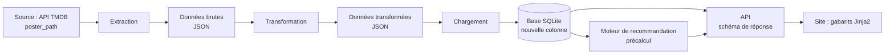

# Guide étudiant — Reprendre l'ETL pour ajouter une donnée
## Exemple : les affiches · Projet CinéData

---

## Introduction

Votre site affiche pour l'instant un visuel de remplacement à la place des affiches : la donnée n'existe pas dans votre pipeline. En projet, c'est une situation courante : un besoin nouveau arrive et il faut **faire traverser une nouvelle information à toute la chaîne** (extraction, transformation, chargement, base, API, affichage). Cet atelier vous apprend à le faire méthodiquement, à vérifier chaque étape, et à compléter des données déjà collectées sans tout recommencer.

---

## Concepts

**Une donnée nouvelle touche plusieurs fichiers.** Il faut la récupérer à la source, la transporter, la stocker, l'exposer, puis l'afficher. Oublier une étape ne provoque pas toujours une erreur : parfois la donnée disparaît **sans aucun message**. Vérifiez donc après chaque étape que la donnée est bien là.

**Compléter plutôt que recommencer.** La liste de films populaires de TMDB change chaque jour : relancer toute l'extraction donnerait d'autres films, et vos données MovieLens et Wikipédia ne correspondraient plus. On écrit donc un **script de reprise** qui complète les films déjà extraits, puis on rejoue la suite du pipeline.

**Stocker le minimum, construire le reste.** TMDB fournit un chemin relatif d'affiche (`/abc123.jpg`). On stocke ce chemin ; l'adresse complète se construit à l'affichage avec une adresse de base et une taille, définies en configuration. Si la taille change, aucune donnée n'est à modifier.

---

## Définitions

| Terme | Signification |
|---|---|
| `poster_path` | Chemin relatif de l'affiche d'un film dans TMDB (peut être `null`) |
| Script de reprise | Script qui complète des données existantes, sans refaire toute l'extraction |
| Idempotent | Qu'on peut relancer sans risque : un second passage ne change rien de plus |
| Échec silencieux | Une erreur qui ne produit aucun message : la donnée manque, sans signal |
| Artefact périmé | Un fichier précalculé (ici, la matrice de recommandation) qui ne reflète plus la base actuelle |
| `NaN` | Valeur manquante des tableaux pandas : c'est un nombre à virgule, pas `None` |

---

## Mise en œuvre

### 1. Dresser la carte avant de coder

Listez, pour **votre** projet, chaque fichier par lequel la donnée passera : extraction, transformation, schéma de la base, fonction d'insertion, requête de précalcul, schéma de réponse de l'API, gabarit. Pour chacun, notez ce qu'il faut changer, ou pourquoi rien n'est à changer.

### 2. Ajouter la donnée à la source de l'extraction

Dans votre script d'extraction TMDB, ajoutez `poster_path` aux champs conservés. Dans `config.yaml`, ajoutez l'adresse de base des images et la taille choisie.

### 3. Compléter les données déjà extraites

Écrivez un script de reprise qui :
- charge votre fichier JSON brut ;
- pour chaque film **qui n'a pas encore** le champ, appelle TMDB et l'ajoute ;
- compte les échecs et peut être **relancé** sans refaire ce qui est déjà fait ;
- fait une **copie de sécurité** du fichier avant de le modifier.

Réutilisez la fonction d'appel de votre script d'extraction plutôt que de la recopier.

### 4. Rejouer la suite du pipeline

Dans cet ordre :
1. relancez la transformation ;
2. **supprimez le fichier de base** (une table existante n'est pas modifiée par `CREATE TABLE IF NOT EXISTS`) ;
3. rechargez ;
4. relancez le précalcul de la recommandation ;
5. redémarrez l'API.

### 5. Vérifier à chaque étape

| Après… | Vérification |
|---|---|
| Le script de reprise | Le fichier brut contient `poster_path` (certains à `null`) |
| Le chargement | `SELECT COUNT(*) FROM films WHERE poster_path IS NOT NULL;` |
| Le précalcul | La réponse de la route de recommandation contient `poster_path` |
| L'API | La route de détail d'un film renvoie `poster_path` |
| Le site | L'affiche s'affiche ; le visuel de remplacement apparaît pour les films sans affiche |

### Points de vigilance

- **Liste de colonnes oubliée.** Votre fonction d'insertion liste les colonnes une à une : si `poster_path` n'y figure pas, le chargement réussit mais la colonne reste vide, sans erreur.
- **Schéma de réponse oublié.** Si le champ n'est pas déclaré dans le modèle Pydantic de réponse, l'API le supprime silencieusement.
- **Valeur manquante dans un tableau pandas.** Un film sans affiche donne un `NaN`, pas `None` : testez avec `pd.isna()`, jamais avec `if not valeur`. Testez toujours votre chaîne sur un film **sans** affiche.
- **Base ou artefact périmé.** Après toute modification du schéma, repartez d'une base vide ; après tout rechargement, relancez le précalcul.
- **Clé API.** Elle reste dans votre fichier `.env`, jamais dans le code ni dans Git.

---

## Pour aller plus loin

- Refaites le parcours avec un **second champ** de votre choix (par exemple l'image de fond) et comptez les fichiers touchés : combien de temps gagne-t-on avec une carte préparée à l'avance ?
- Ajoutez une **miniature** dans la liste des films, avec une taille d'image plus petite en configuration.
- Ajoutez à votre page de qualité des données un indicateur sur les affiches manquantes.
- Réfléchissez : comment **automatiser** ces vérifications pour ne plus les faire à la main ? (lien avec les tests automatisés vus plus tard dans la formation)

---

## Ressource complémentaire

**Documentation TMDB, section sur les images** — comment est construite l'adresse d'une image (adresse de base, taille, chemin) et quelles tailles sont disponibles. À retrouver depuis la documentation officielle de l'API TMDB.
